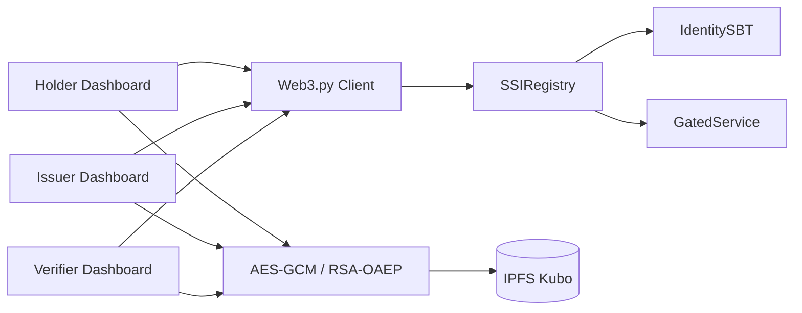

<p align="center">
  <a href="https://www.uit.edu.vn/" title="Trường Đại học Công nghệ Thông tin">
    
  </a>
</p>

<h1 align="center"><b>IS355.R11 — BLOCKCHAIN SSI TRÊN ETHEREUM</b></h1>

<p align="center">
  Nền tảng Self-Sovereign Identity tối thiểu phục vụ đồ án học phần
</p>

<p align="center">
  
  
  
  
  
</p>

> [!IMPORTANT]
> Đây là **skeleton MVP phục vụ học tập**, chưa phải hệ thống SSI/Verifiable Credential hoàn chỉnh. Các dashboard hiện là scaffold; IPFS end-to-end và Sepolia vẫn cần nhóm tiếp tục triển khai, kiểm thử và lưu bằng chứng thật.

---

## Mục lục

- [1. Giới thiệu](#1-giới-thiệu)
- [2. Trạng thái hiện tại](#2-trạng-thái-hiện-tại)
- [3. Kiến trúc tổng quan](#3-kiến-trúc-tổng-quan)
- [4. Công nghệ sử dụng](#4-công-nghệ-sử-dụng)
- [5. Cấu trúc repository](#5-cấu-trúc-repository)
- [6. Cài đặt trên Windows](#6-cài-đặt-trên-windows)
- [7. Chạy và kiểm thử](#7-chạy-và-kiểm-thử)
- [8. Phân công nhóm](#8-phân-công-nhóm)
- [9. Tài liệu dự án](#9-tài-liệu-dự-án)
- [An toàn và giới hạn phạm vi](#an-toàn-và-giới-hạn-phạm-vi)

---

## 1. Giới thiệu

Repository xây dựng nền tảng tối thiểu cho đồ án **Blockchain SSI trên Ethereum**, trong đó:

- **Holder** đăng ký DID mô phỏng và yêu cầu cấp credential.
- **Issuer** kiểm tra hồ sơ, ký và phát hành credential.
- **Verifier** xác minh trạng thái công khai và kiểm tra quyền truy cập.
- Hồ sơ nhạy cảm được mã hóa ngoài chuỗi; blockchain chỉ lưu hash, CID, chữ ký và trạng thái cần thiết.
- `IdentitySBT` biểu diễn credential không chuyển nhượng.
- `GatedService` minh họa dịch vụ chỉ cho Holder có credential hợp lệ truy cập.

Thiết kế bám theo bốn tài liệu đã thống nhất: outline SSI bản 3, Project Charter, architecture mới nhất và WBS 5 Phase. Nếu có điểm không nhất quán, repository ưu tiên architecture mới nhất.

Giao diện tích hợp giữa bốn mảng đã được khóa tại [`docs/2-planning-phase/interfaces.md`](docs/2-planning-phase/interfaces.md) — **FROZEN v1**. Bốn thành viên có thể phát triển song song dựa trên tài liệu này.

---

## 2. Trạng thái hiện tại

| Hạng mục | Trạng thái | Ghi chú |
|---|:---:|---|
| Ba smart contract | ✅ | Compile và có test lõi |
| Vòng đời `REQUESTED → ISSUED → REVOKED` | ✅ | Đã test bằng Hardhat |
| Identity SBT không chuyển nhượng | ✅ | Mint/burn và chặn transfer |
| Token-gated service | ✅ | `accessService(credentialId)` phát event |
| AES-GCM và RSA-OAEP | ✅ | Primitive và unit test đã có |
| Web3.py kết nối Hardhat local | ✅ | Có integration test |
| IPFS Kubo client | ✅ | Đã kiểm thử Kubo thật (0.43.1): upload/retrieve 3 file .enc, byte-for-byte khớp, docHash matches, RSA-OAEP wrap/unwrap trong luồng thực. Xem `evidence/member_b_kubo_e2e.md`. |
| Ba dashboard Streamlit | 🟡 | Hiển thị scaffold; nút ghi chain đang là TODO(C) |
| Deploy Sepolia | ⬜ | Chưa chạy và chưa có tx hash thật |
| Báo cáo/slide/video nghiệm thu | ⬜ | Nhóm tiếp tục thực hiện theo WBS |

Kết quả kiểm thử gần nhất của skeleton:

```text
Hardhat contracts     2 passed
Python crypto unit    2 passed
Web3.py integration   1 passed (khi Hardhat local đang chạy)
```

Quy ước trạng thái credential:

```text
NONE = 0  →  REQUESTED = 1  →  ISSUED = 2  →  REVOKED = 3
```

---

## 3. Kiến trúc tổng quan



### Các nguyên tắc đã khóa

- `credentialId` do Registry sinh tăng dần từ `1`.
- `requestCredential` chứa `wrappedKeyForHolder` và `wrappedKeyForIssuer`.
- `tokenId` của SBT bằng `credentialId`.
- `docHash` là SHA-256 của file PDF bản rõ trước mã hóa.
- Mỗi hồ sơ dùng một AES-256 key; mỗi file có nonce 12 byte riêng.
- AES key được wrap độc lập bằng RSA-OAEP SHA-256 cho từng vai trò.
- Issuer ký digest bằng EIP-191; digest bao gồm contract, chain ID, credential ID, Holder và `docHash`.
- Contract không giải mã dữ liệu; crypto và IPFS được xử lý bằng Python.

Chi tiết đầy đủ nằm trong [`architecture.md`](docs/2-planning-phase/architecture.md) và [`interfaces.md`](docs/2-planning-phase/interfaces.md).

---

## 4. Công nghệ sử dụng

| Thành phần | Công nghệ |
|---|---|
| Smart contract | Solidity 0.8.x, OpenZeppelin Contracts 5.x |
| Phát triển blockchain | Hardhat, TypeScript, Ethers.js |
| Blockchain local/testnet | Hardhat Network, Ethereum Sepolia |
| Backend adapter | Python, Web3.py, eth-account |
| Mã hóa | cryptography: AES-256-GCM, RSA-OAEP SHA-256 |
| Lưu trữ ngoài chuỗi | IPFS Kubo HTTP API |
| Giao diện | Streamlit — Holder, Issuer, Verifier |
| Kiểm thử | Hardhat/Chai, pytest + Web3.py |

---

## 5. Cấu trúc repository

```text
ssi-ethereum-skeleton/
├── contracts/                  # A — SSIRegistry, IdentitySBT, GatedService
├── scripts/                    # A — Deploy contract và cấp ISSUER_ROLE
├── crypto/                     # B — AES-GCM, RSA-OAEP và hashing
├── ipfs/                       # B — Kubo HTTP client
├── web3_client/                # C — RPC, artifact và contract adapter
├── app/                        # C — Holder, Issuer, Verifier dashboard
├── test/                       # D — Hardhat contract tests
├── tests/                      # D — pytest unit và integration
├── docs/                       # Charter, WBS, architecture, spec và test plan
├── deployments/               # Địa chỉ local/testnet; JSON thật bị Git ignore
├── .env.example               # Mẫu biến môi trường, không chứa khóa thật
├── TEAM_HANDOFF.md             # Bàn giao và phân công chi tiết
├── hardhat.config.ts
├── package.json
└── requirements.txt
```

---

## 6. Cài đặt trên Windows

### 6.1 Yêu cầu

- Node.js 20 LTS và npm.
- Python 3.11 hoặc 3.12.
- Git.
- IPFS Kubo nếu phát triển phần IPFS.

### 6.2 Cài dependencies

Mở PowerShell tại thư mục repository:

```powershell
npm install
py -3.11 -m venv .venv
.\.venv\Scripts\Activate.ps1
python -m pip install --upgrade pip
python -m pip install -r requirements.txt
Copy-Item .env.example .env
```

Chỉ điền private key của account Hardhat local hoặc ví Sepolia dành riêng cho đồ án. Không sử dụng ví chứa tài sản thật.

---

## 7. Chạy và kiểm thử

### 7.1 Compile và test nhanh

```powershell
npm run compile
npm test
python -m pytest tests\unit -q
```

### 7.2 Hardhat local và integration test

Terminal 1:

```powershell
npm run node
```

Terminal 2:

```powershell
.\.venv\Scripts\Activate.ps1
python -m pytest tests\integration -q
```

Integration test sẽ `skip` có giải thích nếu artifact chưa được compile hoặc Hardhat local chưa chạy.

### 7.3 Deploy local và cấp role

Giữ Hardhat node đang chạy, sau đó mở terminal khác:

```powershell
npm run deploy:local
npm run roles:local
```

Script deploy ghi địa chỉ vào `deployments/localhost.json`. File deployment thật bị Git ignore để tránh dùng nhầm môi trường.

### 7.4 Chạy ba dashboard

Chạy mỗi dashboard ở một terminal riêng:

```powershell
streamlit run app\holder.py
streamlit run app\issuer.py
streamlit run app\verifier.py
```

> [!NOTE]
> Dashboard hiện là scaffold trung thực: có kết nối và form nhưng các nút gửi giao dịch đang bị vô hiệu hóa cho tới khi thành viên C nối ABI, ví demo và luồng của B.

### 7.5 IPFS Kubo

```powershell
ipfs init
ipfs daemon
```

`ipfs/kubo_client.py` chỉ nhận file `.enc`. IPFS không phải private storage; tính bí mật phụ thuộc vào AES/RSA và cách quản lý khóa.

#### Cách sử dụng nhanh (Crypto & IPFS - Member B)

```python
from crypto.crypto_utils import (
    new_aes_key, generate_rsa_keypair, encrypt_package, decrypt_package,
    sha256_bytes, wrap_key_for_roles, unwrap_key,
)
from ipfs.kubo_client import KuboClient

# 1. Sinh khóa AES-256 cho gói hồ sơ và cặp RSA Holder/Issuer
aes_key = new_aes_key()
holder_priv, holder_pub = generate_rsa_keypair("mat-khau-pem")
issuer_priv, issuer_pub = generate_rsa_keypair("mat-khau-pem")

# 2. docHash = SHA-256 của diploma.pdf bản rõ (trước mã hóa)
doc_hash = sha256_bytes(diploma_pdf_bytes)

# 3. Mã hóa mỗi file độc lập, nonce 12 byte khác nhau; lưu *.enc
pkg = encrypt_package(file_bytes, aes_key)
enc_bytes = pkg.pack()  # wire format: nonce[12] || ciphertext || tag[16]

# 4. Bọc khóa AES riêng cho Holder và Issuer (RSA-OAEP, SHA-256)
wrapped_holder, wrapped_issuer = wrap_key_for_roles(aes_key, holder_pub, issuer_pub)

# 5. Upload chỉ file đã mã hóa lên Kubo, tải lại bằng CID
client = KuboClient()
cid = client.add_bytes(enc_bytes, "diploma.pdf.enc")
retrieved = client.cat(cid)  # bytes bằng hệt bản upload

# 6. Khôi phục khóa AES bằng private key Holder, giải mã và xác thực
aes_key_again = unwrap_key(wrapped_holder, holder_priv, "mat-khau-pem")
plaintext = decrypt_package(pkg, aes_key_again)
assert sha256_bytes(plaintext) == doc_hash  # nếu là diploma.pdf
```

- Không upload dữ liệu thô, khóa riêng RSA hoặc mật khẩu lên IPFS/Git.
- Test IPFS dùng giả Kubo (mock); chạy kiểm thử thật cần `ipfs daemon` tại `127.0.0.1:5001`.

### 7.6 Sepolia

Điền `SEPOLIA_RPC_URL` và `DEPLOYER_PRIVATE_KEY` vào `.env`, sau đó:

```powershell
npm run deploy:sepolia
npm run roles:sepolia
```

Script hiện chỉ deploy/cấp role. Chưa được tuyên bố Sepolia thành công cho tới khi nhóm có contract address và transaction hash thật.

---

## 8. Phân công nhóm

| Vai trò | Phạm vi chính | Thư mục |
|---|---|---|
| **A — Smart Contract** | Contract, role, test contract, deploy Sepolia | `contracts/`, `scripts/` |
| **B — Crypto & IPFS** | AES/RSA, hashing, upload/retrieve Kubo | `crypto/`, `ipfs/` |
| **C — Web3.py & UI** | Contract wrapper và ba dashboard Streamlit | `web3_client/`, `app/` |
| **D — Tests & Docs** | Integration test, test report, WBS và tài liệu nghiệm thu | `test/`, `tests/`, `docs/` |

Chi tiết công việc, tiêu chí hoàn thành và cách phối hợp song song: [`TEAM_HANDOFF.md`](TEAM_HANDOFF.md).

---

## 9. Tài liệu dự án

| Tài liệu | Nội dung |
|---|---|
| [`project-charter.md`](docs/1-initiation-phase/project-charter.md) | Mục tiêu, phạm vi, vai trò và kế hoạch tổng thể |
| [`wbs.xlsx`](docs/1-initiation-phase/wbs.xlsx) | WBS 5 Phase |
| [`architecture.md`](docs/2-planning-phase/architecture.md) | Kiến trúc mới nhất và luồng nghiệp vụ |
| [`contracts-spec.md`](docs/2-planning-phase/contracts-spec.md) | Đặc tả ba smart contract |
| [`interfaces.md`](docs/2-planning-phase/interfaces.md) | ABI, crypto, signature và key policy FROZEN v1 |
| [`key-management.md`](docs/2-planning-phase/key-management.md) | Quy tắc quản lý khóa demo |
| [`test-plan.md`](docs/4-testing-phase/test-plan.md) | Test hiện có và các test còn TODO |

---

## An toàn và giới hạn phạm vi

### Không được commit

- `.env` thật, seed phrase hoặc private key Ethereum.
- RSA private PEM, mật khẩu PEM hoặc keystore.
- Hồ sơ, ảnh cá nhân hoặc bằng cấp thật.
- `node_modules`, môi trường Python, artifact/cache và deployment JSON cục bộ.

### Ngoài phạm vi phiên bản này

- Zero-knowledge proof.
- Multi-chain hoặc bridge.
- DID deactivation độc lập.
- Marketplace, ERC-20 hoặc thanh toán.
- Production key custody và production deployment.

Trước mỗi commit, chạy `git status` và kiểm tra toàn bộ file staged. Chỉ đánh dấu một chức năng hoàn thành khi có code chạy được và bằng chứng kiểm thử tương ứng.

---

<p align="center">
  <b>Blockchain SSI — học tập, kiểm chứng được và không lưu dữ liệu nhạy cảm trực tiếp on-chain.</b>
</p>
