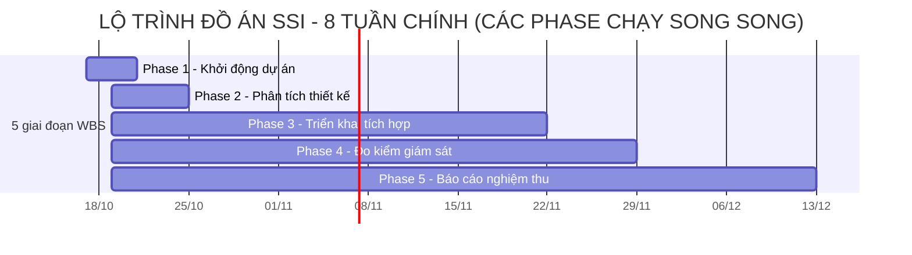

  

<h1 align="center"><b>ĐỒ ÁN MÔN BLOCKCHAIN — BÀI TẬP 01</b></h1>

<b>HỆ THỐNG ĐỊNH DANH PHI TẬP TRUNG (SSI) TRÊN ETHEREUM</b>

<b>HIẾN CHƯƠNG DỰ ÁN — PROJECT CHARTER</b>

---
## MỤC LỤC
- [1. Thông tin chung](#1-thông-tin-chung)
- [2. Bối cảnh & Mục tiêu dự án](#2-bối-cảnh--mục-tiêu-dự-án)
- [3. Phạm vi dự án](#3-phạm-vi-dự-án)
- [4. Đội ngũ thực hiện & Phân công trách nhiệm](#4-đội-ngũ-thực-hiện--phân-công-trách-nhiệm)
- [5. Kế hoạch triển khai & Sản phẩm bàn giao](#5-kế-hoạch-triển-khai--sản-phẩm-bàn-giao)
- [6. Ngân sách & Quản trị tài nguyên](#6-ngân-sách--quản-trị-tài-nguyên)
- [7. Tiêu chí thành công & Nghiệm thu](#7-tiêu-chí-thành-công--nghiệm-thu)

---

## 1. Thông tin chung

### 1.1 Thông tin đề tài

- **Môn học:** Blockchain (mã lớp: **[IS355.R11]**).
- **Đơn vị:** Trường Đại học Công nghệ Thông tin, ĐHQG-HCM.
- **Giảng viên hướng dẫn:** **[Hà Lê Hoài Trung]**.
- **Tên bài tập:** **Bài tập 01 — Xây dựng hệ thống định danh phi tập trung (Self-Sovereign Identity — SSI)**.
- **Tên dự án:** **Hệ thống định danh phi tập trung (SSI) trên Ethereum**.
- **Kịch bản xuyên suốt:** Trường đại học cấp chứng chỉ/bằng tốt nghiệp cho sinh viên; nhà tuyển dụng kiểm tra tính hợp lệ và chỉ xem hồ sơ đã mã hóa khi được sinh viên đồng ý.
- **Hình thức:** Prototype học phần (không sử dụng hồ sơ định danh thật, không cam kết tuân thủ DID/VC chuẩn W3C đầy đủ).
- **Nền tảng dự kiến:** Ethereum Sepolia, smart contract Solidity, IPFS, ứng dụng Streamlit sử dụng Web3.py.
- **Kho mã nguồn:** **[Điền URL GitHub của nhóm]**.

### 1.2 Thành viên nhóm

| STT | Ký hiệu theo WBS | MSSV | Họ và tên | Vai trò chính | Email/GitHub |
|:---:|:---:|:---:|:---|:---|:---|
| 1 | **A** | [Điền] | [Điền] | Smart Contract, EIP-191, SBT, triển khai Sepolia | [Điền] |
| 2 | **B** | [Điền] | [Điền] | Mã hóa AES/RSA, quản lý khóa, IPFS, kiểm thử bảo mật | [Điền] |
| 3 | **C** | [Điền] | [Điền] | Web3.py, giao diện Streamlit, tích hợp frontend, video demo | [Điền] |
| 4 | **D** | [Điền] | [Điền] | Phân tích yêu cầu, WBS, kiểm thử tích hợp, tổng hợp báo cáo, slide | [Điền] |

### 1.3 Kế hoạch thời gian tổng thể

- **Khởi động chuẩn bị:** 17–18/10/2026 theo WBS gốc.
- **8 tuần thực hiện chính:** **19/10–13/12/2026**.
- **Mốc bảo vệ/nộp bài cuối:** 13/12/2026 trong kế hoạch gốc; cần xác nhận lại nếu giảng viên công bố lịch chính thức khác.
- **Phương thức theo dõi:** Năm Phase của WBS; một số công việc chạy **song song**, không phải đợi Phase trước kết thúc hoàn toàn.

| Giai đoạn theo WBS gốc | Khoảng thực hiện trong WBS | Nội dung chính |
|:---|:---:|:---|
| **Phase 1: Khởi động dự án** | 17–21/10 | Chốt ý tưởng, công nghệ, phạm vi, phân công, Project Charter. |
| **Phase 2: Phân tích & Thiết kế** | 19–25/10 | WBS, yêu cầu, kiến trúc, đặc tả contract, khóa, giao diện và thống nhất API. |
| **Phase 3: Triển khai & Tích hợp** | 19/10–22/11 | Cài môi trường; phát triển contract, mã hóa/IPFS, Web3.py/Streamlit; tích hợp local; deploy Sepolia. |
| **Phase 4: Đo kiểm & Giám sát** | 19/10–29/11 | Viết test plan từ sớm, unit/integration/security test, kiểm tra Sepolia, sửa lỗi và khóa mã nguồn. |
| **Phase 5: Báo cáo & Nghiệm thu** | 19/10–13/12 | Viết báo cáo song song, slide, video dự phòng, đóng gói mã nguồn, luyện demo và bảo vệ. |

---

## 2. Bối cảnh & Mục tiêu dự án

### 2.1 Bối cảnh thực tiễn

Trong quy trình xác nhận học vấn truyền thống, nhà tuyển dụng thường phải yêu cầu bản scan văn bằng hoặc liên hệ trực tiếp trường cấp bằng. Điều này gây trùng lặp lưu trữ, tốn thời gian xác minh và làm tăng nguy cơ phát tán thông tin cá nhân.

Đồ án đề xuất một **nguyên mẫu SSI** để phân tách:

- **Xác thực công khai:** Smart contract cho phép tra cứu trạng thái chứng chỉ, đơn vị cấp và dấu vết toàn vẹn mà không cần tiết lộ hồ sơ gốc.
- **Dữ liệu hồ sơ:** Tài liệu được **mã hóa trước khi upload lên IPFS**, blockchain lưu CID và hash cần thiết.
- **Chia sẻ có sự đồng ý:** Sinh viên chủ động cấp quyền chia sẻ cho bên xác minh cụ thể; quyền trong ứng dụng được kiểm tra bằng RBAC và consent.
- **Chứng nhận có thể sử dụng:** SBT không chuyển nhượng đại diện cho chứng chỉ/định danh đã xác nhận, phục vụ token-gated access.

Blockchain không tự chứng minh nội dung giấy tờ là đúng trong thế giới thực; **Issuer (Trường đại học)** là bên chịu trách nhiệm thẩm định và ký xác nhận tài liệu mẫu.

### 2.2 Mục tiêu dự án

1. **Smart Contract & Ethereum:** Có tối thiểu 3 nghiệp vụ chính: tạo DID, cấp/xác nhận hash chứng chỉ, xác minh/truy xuất trạng thái; tối thiểu 2 ràng buộc logic về quyền và trạng thái; biên dịch, kiểm thử và deploy trên **Sepolia**.
2. **DApp/Web3.py:** Cung cấp 3 dashboard cho **Holder (Sinh viên)**, **Issuer (Trường)** và **Verifier (Nhà tuyển dụng)**; có tương tác gửi giao dịch, đọc dữ liệu và hiển thị trạng thái.
3. **Mã hóa & IPFS:** Mã hóa AES-256-GCM, dùng RSA-OAEP để bọc khóa AES; upload/retrieve đủ **ảnh JPG, bằng PDF, metadata JSON** và đối chiếu hash sau giải mã.
4. **Quyền riêng tư & phân quyền:** Không đưa họ tên/MSSV hoặc nội dung hồ sơ lên chain dưới dạng rõ; có `ISSUER_ROLE`, kiểm soát phát hành/thu hồi, `grantConsent`/`revokeConsent` và giải thích trung thực giới hạn thu hồi khóa.
5. **SBT & Token-gated access:** Tạo **IdentitySBT (ERC-721 không chuyển nhượng)**; có mint sau khi Credential hợp lệ, burn/vô hiệu hóa khi thu hồi và kiểm tra quyền dùng dịch vụ.
6. **Chứng minh kết quả:** Có automated tests, transaction hash, contract address, ảnh minh chứng, tài liệu báo cáo, slide và kịch bản demo ổn định.

---

## 3. Phạm vi dự án

### 3.1 Trong phạm vi (In-Scope)

| Phân hệ | Hạng mục triển khai |
|:---|:---|
| **SSIRegistry (Solidity)** | Đăng ký khóa công khai, tạo DID mô phỏng `did:ssi:0x…`, yêu cầu cấp chứng chỉ, phát hành/xác minh/thu hồi, quản lý consent, lưu hash/CID/chữ ký và trạng thái. |
| **IdentitySBT + GatedService** | ERC-721 không chuyển nhượng, `tokenId = credentialId`; mint/burn theo Registry; dịch vụ kiểm tra SBT và Credential còn hợp lệ. |
| **Ứng dụng 3 vai trò** | Holder Dashboard (tạo DID, upload, xem hồ sơ/consent); Issuer Dashboard (kiểm tra, cấp, thu hồi, mint SBT); Verifier Dashboard (xác minh, tải và giải mã nếu có consent, thử dịch vụ). |
| **Crypto & key management** | Phân biệt private key ví với RSA; PEM RSA mã hóa mật khẩu; AES-GCM dùng nonce khác nhau cho mỗi file; Holder bọc AES key cho mình và bên được cấp quyền. |
| **Lưu trữ IPFS** | Kubo HTTP API; mã hóa trước upload; lưu/tải 3 loại file; lấy CID và xác minh SHA-256 file gốc. |
| **Môi trường & thử nghiệm** | Hardhat local node để kiểm thử; Web3.py, pytest; test Ethereum Sepolia và minh chứng bằng transaction hash/explorer. |
| **Quản lý & báo cáo** | WBS 5 Phase, repo GitHub, Project Charter, architecture, báo cáo 8 chương, slide, demo và hồ sơ nghiệm thu. |

### 3.2 Ngoài phạm vi (Out-of-Scope)

- Không triển khai hệ thống định danh công dân hoặc xác thực giấy tờ thật trong sản xuất.
- Không tuyên bố DID `did:ssi` tương thích đầy đủ với DID method được công nhận hay toàn bộ W3C DID/VC.
- Không xây dựng Zero-Knowledge Proof, Account Abstraction, multi-chain, marketplace và ERC-20 bổ sung.
- Không triển khai cơ chế deactivation DID độc lập trong bản prototype đã chốt; xác minh hợp lệ dựa trên trạng thái Credential gắn với DID.
- Không làm ứng dụng MetaMask/web client sản xuất hoặc hạ tầng relay chia sẻ khóa riêng. Bản demo dùng Web3.py/Streamlit **trên máy cục bộ và ví testnet chuyên dụng**.
- Không bảo đảm thu hồi có thể khiến Verifier đã từng được cấp khóa mất quyền giải mã file cũ. Blockchain/IPFS không cung cấp tính năng xóa lịch sử.

---

## 4. Đội ngũ thực hiện & Phân công trách nhiệm

| Thành viên | Trách nhiệm chính theo WBS | Sản phẩm/đầu ra phụ trách |
|:---|:---|:---|
| **A — Smart Contract** | Thiết kế kiến trúc và trạng thái, phát triển `SSIRegistry`, consent, `IdentitySBT`, `GatedService`, unit test contract, deploy Sepolia, đóng gói repo. | `architecture.md`, `contracts-spec.md`, `.sol`, contract address, giao dịch Sepolia, tài liệu triển khai. |
| **B — Crypto & IPFS** | Thiết kế quản lý khóa, hiện thực AES/RSA và chữ ký hỗ trợ, upload/retrieve IPFS, kiểm thử bảo mật, RBAC và consent. | `key-management.md`, `crypto/`, `ipfs/`, kiểm thử và minh chứng mã hóa/truy xuất. |
| **C — Web3.py & Frontend** | Wireframe, 3 dashboard Streamlit, Web3.py RPC/ABI, trải nghiệm gửi/đọc giao dịch, video demo có caption. | `app/`, `web3_client/`, 3 dashboard, ảnh giao diện, video dự phòng. |
| **D — Kiểm thử & Tài liệu** | WBS, Charter, requirements, test plan, integration/Sepolia test, báo cáo kiểm thử, tổng hợp báo cáo và slide. | WBS, `project-charter.md`, `requirements.md`, `test-plan.md`, test report, báo cáo và slide. |
| **Cả nhóm** | Chốt phạm vi, giao diện chung, môi trường, tích hợp end-to-end, review tiến độ, sửa lỗi, luyện demo và bảo vệ. | Biên bản review, phiên bản chạy ổn định, demo và sản phẩm nộp. |

**Quy ước phối hợp:** Mỗi hạng mục có đầu mối chính; các thay đổi ABI, định dạng chữ ký, mã CID, wrapped key hoặc trạng thái Credential phải được trao đổi và cập nhật tài liệu giao diện chung trước khi merge. Sử dụng GitHub Issue/PR để lưu minh chứng đóng góp.

---

## 5. Kế hoạch triển khai & Sản phẩm bàn giao

### 5.1 Lộ trình các giai đoạn thực hiện

**Các mốc kiểm soát theo WBS gốc:**

| Ngày dự kiến | Mốc | Minh chứng cần có |
|:---:|:---|:---|
| **21/10** | Phân công, WBS và Project Charter | `project-charter.md`, WBS cập nhật. |
| **25/10** | Đóng băng thiết kế | `architecture.md`, `contracts-spec.md`, `key-management.md`, `interfaces.md`, wireframe. |
| **01/11** | SSIRegistry và crypto bản đầu | Code compile, unit test cốt lõi và thử mã hóa/giải mã. |
| **08/11** | Consent và IPFS | Luồng xin cấp, consent cơ bản, upload/retrieve 3 file mã hóa. |
| **15/11** | Tích hợp end-to-end local & đánh giá giữa kỳ | Demo ba vai trò trên chain local, SBT và token-gated access. |
| **22/11** | Hoàn tất chức năng thử nghiệm trên Sepolia | Địa chỉ contract, test/tx hash và minh chứng theo rubric. |
| **29/11** | Báo cáo test, sửa lỗi và đóng băng mã | Báo cáo test, Git tag, lỗi quan trọng đã xử lý. |
| **06/12** | Hoàn thiện tài liệu trình bày | Báo cáo Word, slide, ảnh và video nếu dùng (có caption). |
| **13/12** | Nộp và bảo vệ theo kế hoạch gốc | Repo, tài liệu, demo, bộ minh chứng và phần phản biện. |

### 5.2 Danh mục sản phẩm bàn giao (Deliverables)

| Mã | Sản phẩm bàn giao | Mô tả |
|:---:|:---|:---|
| **D01** | Project Charter, WBS | Mục tiêu, phạm vi, vai trò, lịch 8 tuần và trạng thái công việc. |
| **D02** | Đặc tả và kiến trúc hệ thống | `architecture.md`, `requirements.md`, `contracts-spec.md`, `interfaces.md`, sơ đồ Mermaid. |
| **D03** | Ba smart contract | `SSIRegistry.sol`, `IdentitySBT.sol`, `GatedService.sol`, ABI và triển khai Sepolia. |
| **D04** | Ứng dụng Streamlit/Web3.py | 3 dashboard, chức năng đọc, ký/gửi giao dịch và xác minh. |
| **D05** | Crypto/IPFS | Mã hóa AES-GCM, RSA-OAEP, upload/retrieve JPG/PDF/JSON, quản lý khóa demo. |
| **D06** | Bộ kiểm thử và minh chứng | pytest local, integration/security tests, Sepolia tx hash, ảnh demo, báo cáo lỗi. |
| **D07** | Báo cáo & Slide | Báo cáo học thuật 8 chương, tài liệu tham khảo, bảng viết tắt, hình/bảng có caption và slide. |
| **D08** | Bộ demo và đóng gói | README, tài liệu chạy lại, Git tag và video có caption nếu nhóm dùng. |

---

## 6. Ngân sách & Quản trị tài nguyên

### 6.1 Nguyên tắc ngân sách

Đây là đồ án học phần, **chưa có ngân sách tiền tệ chính thức do nhóm cung cấp**. **Chi phí tiền mặt dự kiến: 0 VNĐ** nếu sử dụng máy tính sẵn có, công cụ mã nguồn mở, test ETH từ faucet, RPC miễn phí và IPFS Kubo chạy cục bộ. Đây là **mục tiêu chi phí**, không phải bảo đảm tất cả dịch vụ luôn miễn phí; nếu phát sinh dịch vụ RPC/pinning trả phí hoặc chi phí vận hành khác, nhóm sẽ thống nhất và cập nhật WBS trước khi sử dụng. Các nguồn lực và rủi ro chi phí được theo dõi như sau:

| Tài nguyên | Cách sử dụng | Rủi ro/biện pháp |
|:---|:---|:---|
| **Máy tính cá nhân (4 máy)** | Phát triển Solidity, Python, Streamlit, Kubo và local node. | Thống nhất phiên bản, có hướng dẫn chạy và mẫu `.env.example`. |
| **Hardhat local node** | Unit/integration test không tốn phí gas thực. | Reset fixture và dữ liệu thử nghiệm để test có thể lặp lại. |
| **Ethereum Sepolia** | Deploy và gửi giao dịch xác minh trước demo. | Test ETH từ faucet có thể giới hạn; chuẩn bị sớm, lưu lịch sử giao dịch. |
| **RPC Sepolia** | Kết nối qua dịch vụ RPC hoặc endpoint phù hợp. | Có thể có giới hạn truy cập; giám sát kết nối và giữ cấu hình dự phòng. |
| **IPFS Kubo/pinning** | Lưu 3 file đã mã hóa và truy xuất trong demo. | Nội dung có thể không luôn sẵn sàng nếu không pin; giữ bản dữ liệu mẫu/pin trên node. |
| **GitHub & tài liệu** | Quản lý code, PR/Issue, báo cáo. | Không commit private key, mật khẩu PEM, `.env`, hồ sơ thật. |

### 6.2 Rủi ro chính và phương án ứng phó

| Rủi ro | Ảnh hưởng | Phương án kiểm soát |
|:---|:---|:---|
| ABI hoặc định dạng chữ ký không khớp Python/Solidity | Không issue/verify được | Chốt `interfaces.md`, kiểm thử EIP-191 trên local trước tích hợp. |
| Lộ khóa ví/RSA hoặc dùng giấy tờ thật | Mất an toàn thông tin | Chỉ dùng ví testnet và dữ liệu giả; mã hóa PEM; không đưa secrets lên git. |
| Testnet/RPC/IPFS không ổn định khi demo | Giao dịch/truy xuất bị gián đoạn | Có transcript giao dịch trước, video dự phòng có caption, và kịch bản local. |
| Một thành viên chậm làm chặn người khác | Trễ tích hợp | Theo dõi công việc phụ thuộc, họp hằng tuần, hỗ trợ chéo. |
| Hiểu sai RBAC/consent/thu hồi | Bị phản biện về bảo mật | Báo cáo rõ: quyền ứng dụng khác tính bí mật IPFS; không thể thu hồi dữ liệu đã được cấp khóa. |

---

## 7. Tiêu chí thành công & Nghiệm thu

| STT | Nhóm tiêu chí rubric | Điều kiện cần chứng minh | Điểm tối đa |
|:---:|:---|:---|:---:|
| **1** | **Xây dựng & triển khai Smart Contract** | Có ít nhất 3 nghiệp vụ; ít nhất 2 ràng buộc logic (kèm giải thích kỹ thuật, test hợp lệ/không hợp lệ); deploy & kiểm thử Sepolia; minh họa hàm. | **10** |
| **2** | **Tương tác Web3.py / Frontend** | 3 dashboard theo vai trò; ít nhất 3 tương tác on-chain (gửi giao dịch, đọc, trạng thái); mã hóa dữ liệu nhạy cảm; demo ổn định (rubric ghi tối đa 1 lỗi giao dịch). | **10** |
| **3** | **Lưu trữ IPFS** | Có JPG, PDF, JSON; upload và retrieve; kiểm soát truy cập theo vai trò và consent ở mức contract/ứng dụng; file đã mã hóa giải mã đúng khi được cấp quyền. | **10** |
| **4** | **ERC-20 hoặc NFT** | Dự án chọn NFT/SBT: triển khai contract; có ít nhất 2 nghiệp vụ `mint` và xác thực token-gated; kiểm thử mint/revoke/chặn chuyển nhượng. | **10** |
| **5** | **Báo cáo & Thuyết trình** | Không lỗi chính tả, số trang/slide, caption hình/bảng/video, bảng viết tắt, tài liệu tham khảo, nền/chữ tương phản; cỡ chữ Word >14pt và slide >18pt. | **10** |
| | **TỔNG** | | **50** |

**Nguyên tắc nghiệm thu:** Chỉ đánh dấu *Đã hoàn thành* khi có bằng chứng chạy được hoặc sản phẩm tài liệu tương ứng. Kết quả kiểm thử, địa chỉ contract và đường dẫn explorer được điền **sau** khi triển khai, không ghi trước là đã thành công.

---

