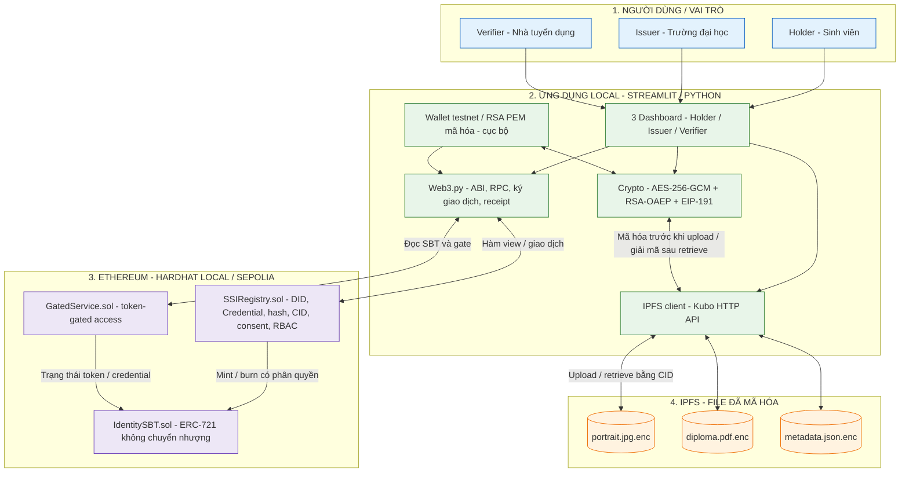
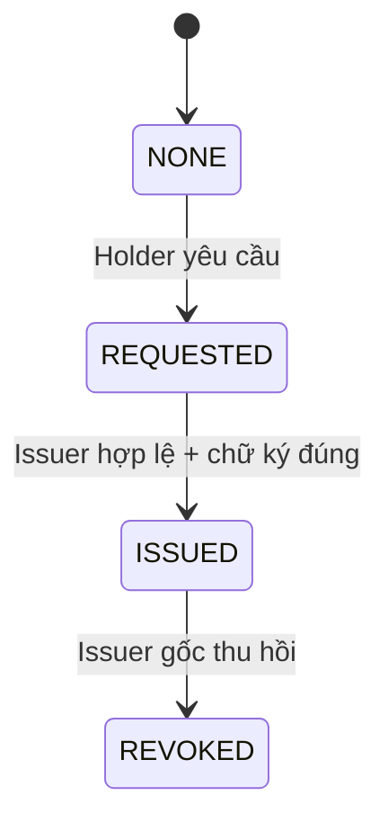

<p align="center">
  <a href="https://www.uit.edu.vn/" title="Trường Đại học Công nghệ Thông tin">
    
  </a>
</p>

<h1 align="center"><b>ĐỒ ÁN MÔN BLOCKCHAIN — BÀI TẬP 01</b></h1>
<p align="center"><b>THIẾT KẾ KIẾN TRÚC HỆ THỐNG ĐỊNH DANH PHI TẬP TRUNG (SSI) TRÊN ETHEREUM</b></p>

---

## MỤC LỤC
- [1. Tổng quan kiến trúc](#1-tổng-quan-kiến-trúc)
- [2. Sơ đồ kiến trúc hệ thống](#2-sơ-đồ-kiến-trúc-hệ-thống)
- [3. Các lớp công nghệ và thành phần](#3-các-lớp-công-nghệ-và-thành-phần)
- [4. Chi tiết các phân hệ chức năng](#4-chi-tiết-các-phân-hệ-chức-năng)
- [5. Các luồng dữ liệu & xử lý nghiệp vụ](#5-các-luồng-dữ-liệu--xử-lý-nghiệp-vụ)
- [6. Mô hình dữ liệu, phân quyền và bảo mật](#6-mô-hình-dữ-liệu-phân-quyền-và-bảo-mật)
- [7. Triển khai, kiểm thử và tích hợp](#7-triển-khai-kiểm-thử-và-tích-hợp)

---

## 1. Tổng quan kiến trúc

Hệ thống được thiết kế theo mô hình **DApp kết hợp lưu trữ ngoài chuỗi**, gồm ba lớp chính:

1. **Ứng dụng người dùng (Streamlit + Web3.py):** Ba dashboard theo vai trò, tạo/đọc giao dịch, chuẩn bị dữ liệu, mã hóa và giải mã ở môi trường local.
2. **Ethereum (Solidity Smart Contracts):** Duy trì DID mô phỏng, trạng thái Credential, quyền Issuer, consent, hash/CID, chữ ký Issuer và SBT không chuyển nhượng.
3. **IPFS (Kubo):** Lưu tệp JPG/PDF/JSON **sau khi mã hóa bằng AES-256-GCM**, truy xuất bằng CID.

**Nguyên tắc thiết kế:**

- Không lưu họ tên, MSSV hoặc nội dung giấy tờ **dạng rõ** trên blockchain.
- Chỉ đơn vị có `ISSUER_ROLE` được phát hành; chỉ Issuer đã phát hành được thu hồi chứng chỉ đó.
- Credential có vòng đời `NONE → REQUESTED → ISSUED → REVOKED`; verify trả `valid = false` nếu chưa phát hành hoặc bị thu hồi (không cần xem hồ sơ gốc).
- Dữ liệu IPFS vẫn có thể tải công khai theo CID; **quyền đọc nội dung** phụ thuộc vào khóa giải mã. RBAC/consent của ứng dụng không làm IPFS trở thành mạng riêng.
- Đây là **DID mô phỏng** `did:ssi:0x…`, không tuyên bố tương thích đầy đủ với W3C DID/VC hoặc `did:ethr`.
- Token ERC-721 dạng SBT là bằng chứng đã cấp, **không phải vật thay thế tài liệu gốc** hoặc bằng chứng xác thực thế giới thực nếu Issuer gian lận.

---

## 2. Sơ đồ kiến trúc hệ thống

### 2.1 Sơ đồ tổng thể (Architecture Diagram)



**Chú giải:** Đường giữa Streamlit/Web3.py và contract biểu thị giao tiếp RPC; mũi tên tới IPFS biểu thị lưu/truy xuất nội dung mã hóa. Blockchain lưu hash/CID nhưng **không trực tiếp chứa file PDF/JPG/JSON gốc**.

### 2.2 Quan hệ ba vai trò

| Vai trò | Mô tả | Dashboard | Quyền nổi bật |
|:---|:---|:---|:---|
| **Holder** | Chủ ví và định danh | User Dashboard | Tạo DID, upload file mã hóa, gửi yêu cầu cấp, grant/revoke consent, xem Credential/SBT. |
| **Issuer** | Đơn vị cấp đáng tin cậy | Issuer Dashboard | Xem yêu cầu đã gửi, kiểm tra tài liệu được cung cấp khóa, ký EIP-191, issue/revoke Credential, mint SBT. |
| **Verifier** | Bên cần xác minh | Verifier Dashboard | Gọi verify Credential công khai; khi có consent, nhận wrapped key, tải và giải mã tài liệu; truy cập GatedService. |

**Owner/Admin:** Địa chỉ deploy được dùng bằng script khởi tạo để cấp `ISSUER_ROLE`. Không phát triển dashboard admin riêng trong prototype.

---

## 3. Các lớp công nghệ và thành phần

| Lớp | Công nghệ dự kiến | Vai trò/lý do |
|:---|:---|:---|
| **Blockchain execution** | Ethereum Sepolia; Hardhat local chain | Smart contract, transaction, trạng thái và testnet minh chứng. |
| **Smart contract** | Solidity 0.8.x (cố định compiler khi bắt đầu), OpenZeppelin Contracts 5.x | ERC-721, AccessControl, ECDSA và kiểm tra điều kiện hợp lệ. |
| **DApp/Web3** | Streamlit, Web3.py, `eth-account` | Giao diện ba vai trò, xử lý ABI, gửi giao dịch, chờ receipt, ký thông điệp. |
| **Mã hóa** | Python `cryptography` | AES-256-GCM cho file, RSA-OAEP bọc khóa AES, RSA private key PEM có mật khẩu. |
| **Lưu trữ phi tập trung** | IPFS Kubo và HTTP API (`requests`) | Upload/retrieve ba file mã hóa, lấy CID, thử pinning. |
| **Kiểm thử** | pytest + Web3.py + Hardhat local node | Ca hợp lệ/không hợp lệ, kiểm thử hợp đồng và tích hợp qua RPC. |
| **Quản lý mã nguồn** | Git + GitHub | Lưu code/docs, Issue/PR, hướng dẫn setup và minh chứng. |

**Ranh giới dữ liệu:** Smart contract không thực thi AES/RSA giải mã. Hàm view cho phép xác minh trạng thái trên chain; phần mã hóa, tạo khóa, giải mã file và truy xuất IPFS do Python xử lý.

---

## 4. Chi tiết các phân hệ chức năng

### 4.1 `SSIRegistry.sol` — quản lý định danh, chứng chỉ và consent

**Dữ liệu logic dự kiến:**

- `Identity`: ánh xạ địa chỉ ví ↔ DID mô phỏng, RSA public key liên kết với ví, trạng thái đăng ký.
- `Credential`: `credentialId`, `holder`, `issuer`, `docHash`, ba CID, chữ ký EIP-191, trạng thái, thời điểm cấp/thu hồi.
- `Consent`: theo `credentialId` và `verifier`; trạng thái cấp/thu hồi và wrapped AES key dành cho verifier (khi được cấp).

**Các hàm dự kiến (đặc tả chữ ký chính xác ở `contracts-spec.md`):**

| Hàm | Vai trò được gọi | Hiệu ứng / dữ liệu |
|:---|:---|:---|
| `registerKey` | Người dùng sở hữu ví | Công bố RSA public key liên kết với `msg.sender`. |
| `createDID` | Holder | Tạo DID một lần cho ví; chống đăng ký trùng. |
| `requestCredential` | Holder | Lưu yêu cầu, 3 CID file mã hóa, `wrappedKeyForHolder` (phục hồi sau khi mở lại ứng dụng) **và** `wrappedKeyForIssuer` (đơn vị cấp đọc hồ sơ); trạng thái `REQUESTED`. |
| `issueCredential` | Issuer có quyền | Kiểm tra `ISSUER_ROLE`, yêu cầu hợp lệ, chữ ký EIP-191 và lưu `docHash`, `issuer`; chuyển `ISSUED`. |
| `verifyCredential` | Bất kỳ người đọc nào | Trả `valid`, issuer, trạng thái/thời điểm; `valid=false` khi revoked/non-issued; **không trả nội dung file gốc**. |
| `revokeCredential` | Issuer đã phát hành | Chỉ `credential.issuer == msg.sender`; chuyển `REVOKED`, burn SBT nếu đã mint. |
| `mintSBT` | Issuer đã phát hành | Chỉ cho Credential hợp lệ/chưa revoke; yêu cầu chưa mint trùng. |
| `grantConsent` | Holder | Bật quyền cho Verifier cụ thể và lưu wrapped key theo public key Verifier. |
| `revokeConsent` | Holder | Vô hiệu hóa quyền trong trạng thái contract/ứng dụng; không xóa được khóa lịch sử. |
| `hasAccess` | Bất kỳ người đọc nào | Trả trạng thái consent hiện hành cho credential + verifier. |

**Ràng buộc tiêu biểu:**

- `onlyRole(ISSUER_ROLE)` hoặc `require(hasRole(...))` ở thao tác phát hành/thu hồi/mint.
- `require(credential.issuer == msg.sender)` với thu hồi/mint tương ứng.
- Chỉ ví Holder có quyền grant/revoke consent; không cấp lại Credential đã bị thu hồi.
- Mỗi ví có một DID, mỗi DID có một Credential tốt nghiệp **trong phạm vi demo**.

### 4.2 `IdentitySBT.sol` — NFT định danh không chuyển nhượng

- Kế thừa **ERC-721** của OpenZeppelin 5.x.
- `tokenId = credentialId` để liên kết chứng chỉ và token.
- `SSIRegistry` là thành phần duy nhất được ủy quyền mint/burn, không cho người dùng thông thường tự tạo hoặc hủy.
- Override `_update` để **chặn chuyển token giữa hai địa chỉ khác không**, nhưng cho phép mint từ `address(0)` và burn về `address(0)`.
- Trạng thái Credential nguồn ở Registry quyết định tính hợp lệ. Khi Credential bị revoke, Registry burn SBT trong cùng giao dịch để không xảy ra sai lệch trạng thái.

### 4.3 `GatedService.sol` — chứng minh token-gated access

**Chốt phương án triển khai:** `accessService(uint256 credentialId)` là **hàm gửi giao dịch, không khai báo `view`**.

- Kiểm tra SBT có `tokenId = credentialId` và thuộc về `msg.sender`; đồng thời tra Registry để chắc chắn Credential đang `ISSUED` và còn hợp lệ.
- Nếu hợp lệ, **phát event** `ServiceAccessed(address indexed user, uint256 indexed credentialId)`; transaction receipt và event trên Sepolia là minh chứng cho nghiệp vụ token-gated access.
- Nếu thiếu SBT, không sở hữu SBT hoặc Credential đã thu hồi, contract **revert**. Khi demo tình huống bị từ chối, chỉ mô phỏng bằng `eth_call`/`.call()` và bắt lỗi trên giao diện; không cố tình gửi giao dịch thất bại lên Sepolia (rubric giới hạn lỗi giao dịch).
- Không phát hành thêm token mới, không ghi nhận doanh thu, không triển khai một dịch vụ nghiệp vụ ngoài đề tài.

### 4.4 Web3.py, Streamlit và Crypto/IPFS

| Module | Chức năng |
|:---|:---|
| `app/` | 3 dashboard theo vai trò, nút tương tác, trạng thái giao dịch, kết quả xác minh. |
| `web3_client/` | RPC Sepolia/local, ABI, gas, ký transaction bằng ví testnet cục bộ, gửi và chờ receipt, bắt lỗi revert. |
| `crypto/` | Sinh RSA keypair, lưu PEM mã hóa, sinh AES key, AES-GCM từng file với nonce khác nhau, RSA-OAEP wrap/unwrap key, EIP-191. |
| `ipfs/` | Upload/retrieve ciphertext, quản lý 3 CID, kiểm tra SHA-256 file giải mã. |

---

## 5. Các luồng dữ liệu & xử lý nghiệp vụ

### 5.1 Tạo DID và đăng ký khóa

1. Holder chuẩn bị ví testnet riêng (khóa ví Ethereum theo secp256k1); lưu keystore cục bộ có mật khẩu.
2. Ứng dụng tạo cặp RSA riêng phục vụ trao đổi khóa AES; RSA private key lưu PEM mã hóa mật khẩu.
3. Holder gửi `registerKey` và `createDID` trên `SSIRegistry`; ví và DID mô phỏng gắn với nhau.
4. Ứng dụng hiển thị mã DID, trạng thái giao dịch và block/transaction hash sau khi được xác nhận.

### 5.2 Mã hóa hồ sơ, upload IPFS và yêu cầu chứng chỉ

1. Holder chọn **`portrait.jpg`**, **`diploma.pdf`**, **`metadata.json`** (toàn bộ là dữ liệu giả phục vụ học tập).
2. Sinh một AES-256 key cho bộ hồ sơ; mã hóa từng file bằng **AES-GCM với nonce 12 byte khác nhau** và lưu cả nonce/tag cần thiết cho giải mã.
3. Upload ba ciphertext lên IPFS Kubo; nhận ba CID.
4. Tính `SHA-256` trên **file PDF gốc** trước mã hóa để làm bằng chứng toàn vẹn, tránh nhầm lẫn với CID của ciphertext.
5. Holder bọc AES key bằng RSA public key **của chính Holder** để khôi phục; bọc thêm một bản bằng RSA public key **Issuer** để đơn vị cấp giải mã tài liệu mẫu.
6. Holder gửi `requestCredential` gồm `credentialId`/tham chiếu hồ sơ, ba CID, `wrappedKeyForHolder` và `wrappedKeyForIssuer`; trạng thái chuyển sang `REQUESTED`. **Hai khóa bọc là ciphertext RSA-OAEP riêng cho hai public key khác nhau**, không phải hai AES key khác nhau.

### 5.3 Issuer ký EIP-191, phát hành và mint SBT

1. Issuer dùng RSA private key của mình để unwrap AES key và giải mã bản PDF/JPG/JSON từ IPFS.
2. Sau bước **thẩm định mô phỏng**, Issuer tính `docHash` và xác nhận hash phù hợp với dữ liệu dự kiến cấp.
3. Nội dung cần ký EIP-191 được chốt theo cấu trúc:
   `keccak256(abi.encode(contractAddress, chainId, credentialId, holder, docHash))`.
4. Phía Python ký **32 byte của hash** theo quy tắc `personal_sign`/EIP-191. Phía Solidity tạo **cùng hash**, dùng `MessageHashUtils.toEthSignedMessageHash(...)`, rồi `ECDSA.recover(...)` kiểm tra signer có đúng Issuer gửi giao dịch hay không.
5. `issueCredential` kiểm tra quyền và chữ ký; cập nhật `ISSUED`, lưu dữ liệu chứng nhận cần thiết.
6. Issuer gọi `mintSBT`: token ID bằng credential ID, token thuộc ví Holder. Chữ ký chứng chỉ **khác chữ ký Ethereum dùng gửi giao dịch**.

### 5.4 Verifier kiểm tra và truy xuất có consent

1. Verifier nhập DID/credential ID, gọi `verifyCredential` và kiểm tra `ISSUED`, Issuer hợp lệ, chưa revoke — **không cần đồng ý chia sẻ** để kiểm tra tính hợp lệ công khai.
2. Nếu cần xem tài liệu gốc, Holder gọi `grantConsent(credentialId, verifier, wrappedKeyForVerifier)`.
3. Giao diện kiểm tra `hasAccess`; Verifier tải ciphertext theo CID từ IPFS, dùng RSA private key của mình unwrap AES key và giải mã file.
4. Ứng dụng so sánh `SHA-256(diploma.pdf)` sau giải mã với hash gắn trên Credential; chỉ báo khớp khi bằng nhau.
5. Holder có thể `revokeConsent`; sau đó ứng dụng tuân thủ trạng thái hiện hành sẽ từ chối các lần chia sẻ mới. **Nhưng** Verifier có thể khai thác wrapped key đã tồn tại trong lịch sử blockchain (kể cả khi chưa tải trước lúc revoke), nên hệ thống **không thể thu hồi khả năng giải mã dữ liệu cũ bằng mật mã**.

### 5.5 Thu hồi chứng chỉ và token-gated access

1. Issuer đã phát hành gọi `revokeCredential`.
2. Registry kiểm tra `msg.sender` trùng `credential.issuer`, chuyển Credential sang `REVOKED` và burn SBT tương ứng trong cùng transaction.
3. Sau thu hồi: `verifyCredential` trả `valid=false`; `GatedService.accessService()` không cho phép dùng dịch vụ; việc thử chuyển SBT giữa hai ví luôn bị từ chối theo thiết kế.

### 5.6 Sơ đồ tuần tự cấp và xác minh

```mermaid
sequenceDiagram
    autonumber
    participant H as Holder (Sinh viên)
    participant App as Streamlit / Web3.py
    participant IPFS as IPFS Kubo
    participant R as SSIRegistry
    participant I as Issuer (Trường)
    participant S as IdentitySBT
    participant V as Verifier

    H->>App: Tạo DID và khóa RSA
    App->>R: registerKey() / createDID() [tx]
    H->>App: Chọn JPG + PDF + JSON
    App->>App: AES-GCM mã hóa 3 file; SHA-256 PDF gốc
    App->>IPFS: Upload ciphertext
    IPFS-->>App: 3 CID
    App->>R: requestCredential(3 CID, wrappedHolder, wrappedIssuer) [tx]
    I->>App: Mở hồ sơ yêu cầu
    App->>IPFS: Retrieve ciphertext
    App->>App: RSA unwrap + AES decrypt
    I->>App: Thẩm định, ký EIP-191
    App->>R: issueCredential(docHash, signature) [tx]
    R-->>App: ISSUED
    App->>R: mintSBT(credentialId) [tx]
    R->>S: Mint SBT cho Holder
    V->>R: verifyCredential() [call]
    R-->>V: valid + issuer + trạng thái
    H->>R: grantConsent(verifier, wrapped key) [tx]
    V->>R: hasAccess() [call]
    V->>IPFS: Tải ciphertext theo CID
    IPFS-->>V: Ciphertext
    V->>V: RSA unwrap + AES decrypt + hash check
```

---

## 6. Mô hình dữ liệu, phân quyền và bảo mật

### 6.1 Lưu trữ on-chain / off-chain

| Loại dữ liệu | Nơi lưu | Lưu ý |
|:---|:---|:---|
| Ví Holder / Issuer / Verifier, DID mô phỏng | Ethereum | Địa chỉ và tương tác công khai, không coi là ẩn danh tuyệt đối. |
| RSA public key hoặc thông tin liên kết khóa | Ethereum | Public key dùng bọc AES key, **không dùng tạo địa chỉ Ethereum**. |
| Trạng thái Credential/consent/SBT, issuer, thời gian | Ethereum | Hỗ trợ verify và RBAC. |
| `SHA-256(diploma.pdf)` gốc, signature Issuer | Ethereum | Chứng minh tính toàn vẹn/thẩm quyền cấp, không thay thế thẩm định giấy tờ thật. |
| CID của 3 file ciphertext | Ethereum | CID tham chiếu **file mã hóa**, không mặc nhiên bảo mật người đã biết CID. |
| Wrapped AES key RSA-OAEP cho Holder/Issuer/Verifier | Ethereum | Ciphertext công khai nhưng cần RSA private key tương ứng; dữ liệu lịch sử không xóa được. |
| `portrait.jpg.enc`, `diploma.pdf.enc`, `metadata.json.enc` | IPFS | Nội dung đã mã hóa AES-GCM, cần pin để truy xuất ổn định. |
| Họ tên, MSSV, file gốc dùng để demo | Máy cục bộ / bên trong JSON đã mã hóa | Dùng dữ liệu giả; không đưa dạng rõ lên chain hoặc repo. |
| Wallet private key / RSA private key PEM | Máy local, lưu có mật khẩu | Không commit Git, không gửi lên server dùng chung. |

### 6.2 Trạng thái Credential



- `NONE` phân biệt chưa có Credential và đang yêu cầu cấp.
- `verifyCredential` hợp lệ chỉ khi `ISSUED` và các điều kiện phát hành/xác minh đạt yêu cầu; nếu `REVOKED` thì `valid=false` thay vì revert.
- DID không có luồng deactivation riêng trong phạm vi prototype, cần nói rõ khi phản biện.

### 6.3 Ma trận quyền truy cập (RBAC + consent)

| Hành động | Holder | Issuer có quyền | Verifier |
|:---|:---:|:---:|:---:|
| `createDID`: đăng ký DID cho ví Holder | ✓ | — | — |
| `registerKey`: đăng ký RSA public key cho **ví của chính mình** | ✓ | ✓ | ✓ |
| Yêu cầu cấp Credential cho chính mình | ✓ | — | — |
| Phát hành Credential, mint SBT | — | ✓ (đúng Issuer) | — |
| Thu hồi Credential | — | ✓ (Issuer đã cấp) | — |
| Kiểm tra Credential công khai | ✓ | ✓ | ✓ |
| Grant/revoke consent cho Credential của mình | ✓ | — | — |
| Tải ciphertext từ IPFS khi biết CID | Có thể | Có thể | Có thể |
| Giải mã hồ sơ | ✓ với khóa | ✓ nếu được Holder cung cấp khóa | ✓ khi được bọc khóa cho Verifier (consent) |
| Vào dịch vụ token-gated | ✓ khi SBT hợp lệ | Chỉ nếu chính ví Issuer có SBT hợp lệ | Chỉ nếu chính ví Verifier có SBT hợp lệ |

**Giới hạn quan trọng:** `hasAccess()` và giao diện kiểm tra consent không ngăn người lạ đọc ciphertext hoặc lịch sử on-chain. Bảo mật nội dung do RSA/AES đảm nhiệm. Thu hồi consent chặn hành vi **được hệ thống hỗ trợ sau này**, không thể tước khả năng giải mã của người từng được cấp khóa.

### 6.4 Quy tắc mật mã và bảo mật thực hành

- Ví Ethereum: khóa riêng secp256k1 ký giao dịch; không nhầm với RSA private key.
- RSA keypair: mỗi vai trò một cặp, RSA-2048 cho prototype; private key PEM mã hóa bằng mật khẩu. RSA-OAEP dùng bọc khóa AES; `registerKey` chỉ ghi public key cho `msg.sender`, và giao diện hiển thị địa chỉ ví cùng public key của người nhận để Holder kiểm tra trước khi bọc khóa. Không tự xây PKI mới.
- AES-GCM: một khóa 256 bit mỗi bộ hồ sơ và nonce 12 byte mới cho từng file; mỗi ciphertext cần lưu nonce/tag để giải mã.
- Chữ ký Issuer: domain gồm địa chỉ contract, `chainId`, `credentialId`, `holder`, `docHash`; bên Python và Solidity sử dụng cùng serialization và EIP-191 prefix.
- Chỉ test bằng tài khoản Sepolia và tài liệu giả; `.env`, keystore, RSA PEM bí mật và file dữ liệu thật phải được loại khỏi commit.
- Smart contract không ngăn khả năng brute-force một số hash tài liệu có không gian nhỏ; tránh đưa dữ liệu cá nhân vào các trường công khai hoặc event.

---

## 7. Triển khai, kiểm thử và tích hợp

### 7.1 Môi trường dự kiến

```text
GitHub repository
│
├── contracts/
│   ├── SSIRegistry.sol
│   ├── IdentitySBT.sol
│   └── GatedService.sol
├── app/                    # Streamlit: Holder, Issuer, Verifier
├── web3_client/            # Web3.py, ABI, tx/receipt
├── crypto/                 # AES-GCM, RSA-OAEP, EIP-191 helpers
├── ipfs/                   # Kubo upload/retrieve
├── tests/
│   ├── contracts/
│   ├── crypto/
│   └── integration/
├── scripts/                # Deploy và kịch bản demo local / Sepolia
├── hardhat.config.ts       # Cấu hình compiler và local network
├── requirements.txt        # Thư viện Python
├── docs/
│   ├── 1-initiation-phase/
│   │   ├── project-charter.md
│   │   └── wbs.xlsx
│   ├── 2-planning-phase/
│   │   ├── architecture.md
│   │   ├── requirements.md
│   │   ├── contracts-spec.md
│   │   ├── key-management.md
│   │   └── interfaces.md
│   ├── 4-testing-phase/
│   │   └── test-plan.md
│   └── 5-closure-phase/
│       └── submission-checklist.md
├── README.md
├── .gitignore
└── .env.example
```

### 7.2 Quy trình tích hợp và triển khai

1. **Local:** Hardhat tạo local node; compile Solidity và lấy ABI/artifacts; Web3.py kết nối RPC.
2. **Contract test:** pytest gọi contract trên local chain, kiểm tra các điều kiện `require`, chữ ký và vòng đời Credential; mỗi ca có trạng thái độc lập.
3. **Crypto/IPFS test:** AES-GCM với nonce không lặp, RSA wrap/unwrap, tải IPFS 3 tệp, giải mã và so sánh SHA-256.
4. **Integration test:** Từ Streamlit chạy trọn luồng Holder → Issuer → Verifier, gồm consent, mint SBT, kiểm tra gate, revoke và truy vấn lại.
5. **Sepolia:** Khi local ổn định, deploy 3 contract, cấp quyền Issuer, cập nhật địa chỉ/ABI, chạy bộ giao dịch minh chứng và lưu hash/receipt/explorer URL.
6. **Báo cáo & Demo:** Thu ảnh có chú thích, test report, sơ đồ, mô tả các ràng buộc, chuẩn bị bản chạy local dự phòng và video có caption nếu dùng.

### 7.3 Ca kiểm thử nghiệm thu tối thiểu

| Mã | Ca kiểm thử | Kết quả mong đợi |
|:---:|:---|:---|
| T01 | Tạo DID lần thứ hai từ cùng ví | Revert, không ghi đè DID. |
| T02 | Ví không có `ISSUER_ROLE` gọi issue | Revert. |
| T03 | Chữ ký Issuer không khớp credential/chain/contract | Revert. |
| T04 | Issuer B thu hồi Credential của Issuer A | Revert. |
| T05 | Verify Credential sau revoke | Trả `valid=false` (không revert vì đã thu hồi). |
| T06 | Upload/retrieve JPG/PDF/JSON và giải mã | Cả ba mở được; PDF SHA-256 khớp `docHash`. |
| T07 | Sửa nội dung file sau giải mã | Hash không khớp, xác minh toàn vẹn thất bại. |
| T08 | Verifier chưa consent → có consent → revoke consent | Ứng dụng từ chối → giải mã thành công → từ chối theo trạng thái mới; ghi rõ giới hạn lịch sử khóa. |
| T09 | Mint SBT / thử transfer | Mint thành công; transfer giữa hai ví revert. |
| T10 | Revoke Credential và thử token-gated | SBT bị burn/vô hiệu; gate từ chối. |
| T11 | Local → Sepolia | Contract address/tx hash/receipt minh chứng hoạt động, không dùng số liệu giả. |
| **T12** | AES-GCM mã hóa 3 file bằng cùng một AES key | Ba nonce 12 byte **khác nhau**; giải mã cả ba file thành công, kiểm tra nonce không bị sử dụng lại với cùng khóa. |
| **T13** | `verifyCredential` khi chưa tồn tại hoặc đang ở `REQUESTED` | Trả `valid=false` cho cả hai trường hợp; không nhầm với trạng thái `ISSUED`. |

Các trường `PASS/FAIL`, gas thực tế, địa chỉ contract và URL minh chứng phải được bổ sung **khi thực hiện**, không điền trước.

### 7.4 Tài liệu kỹ thuật tham khảo

- [Ethereum documentation](https://ethereum.org/en/developers/docs/)
- [OpenZeppelin Contracts 5.x](https://docs.openzeppelin.com/contracts/5.x/)
- [ERC-721 (EIP-721)](https://eips.ethereum.org/EIPS/eip-721)
- [EIP-191: Signed Data Standard](https://eips.ethereum.org/EIPS/eip-191)
- [Web3.py documentation](https://web3py.readthedocs.io/)
- [IPFS documentation](https://docs.ipfs.tech/)
- [Python cryptography](https://cryptography.io/en/latest/)
- [W3C DID Core](https://www.w3.org/TR/did/)
- **B1 — Tổng quan Blockchain:** kiến trúc blockchain, hash và chữ ký số ở mức nền tảng.
- **B2 — Cơ chế Bitcoin:** nền tảng về giao dịch, ví và xác minh; chỉ tham khảo đối chiếu, không dùng làm cơ sở triển khai Ethereum.
- **B3 — Các giao thức đồng thuận:** nguyên lý đồng thuận và tính nhất quán của hệ thống blockchain.
- **B4 — Ethereum & DApp:** EVM, smart contract, mô hình DApp; **IPFS chỉ được nhắc là thành phần lưu trữ ngoài chuỗi** trong kiến trúc DApp.
- **B5 — DeFi:** bối cảnh token/asset layer; không xem đây là tài liệu triển khai SBT.
- **Nguồn triển khai chi tiết:** AES-GCM theo [NIST SP 800-38D](https://csrc.nist.gov/pubs/sp/800/38/d/final), RSA-OAEP theo [RFC 8017](https://www.rfc-editor.org/rfc/rfc8017), ERC-721 và SBT theo EIP-721/OpenZeppelin; IPFS theo tài liệu IPFS chính thức.

---
